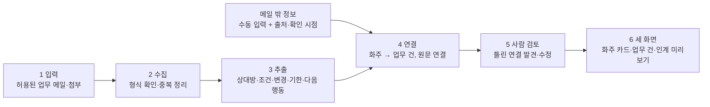

# SynCargo

> 기존 메일과 첨부에서 화주별 약속과 업무 이력을 정리해, 평소에는 필요한 조건과 근거를 빠르게 확인하고 담당자가 바뀔 때도 업무를 이어받게 한다.

SynCargo는 국내 중소 포워딩사를 위한 업무 기록 서비스입니다. 회사가 허용한 업무 메일과 첨부를 읽어 **화주 → 업무 건 → 조건·상태·근거** 순서로 연결하고, 모든 항목을 원문 메일과 함께 보여줍니다. 지금 쓰는 메일과 업무 프로그램(FMS)은 그대로 둡니다.

**현재 상태: MVP 개발 중.** 지금은 가짜 데이터(mock)로 클릭 시연만 되는 화면 데모가 있습니다. 실제 메일 연동·AI·DB는 아직 없습니다. 폴더 구조와 실행 방법은 [시작하기](#시작하기)에 있습니다.

## 해결하려는 문제

포워딩 업무의 조건과 합의는 담당자의 메일함과 기억에 남습니다. 그래서 다음 상황에서 같은 일을 다시 해야 합니다.

- 화주가 "지난번 그 조건 어떻게 했죠?"라고 물으면 메일을 처음부터 다시 뒤진다.
- 휴가·담당 변경·영업→업무 인계 때 진행 중인 건과 남은 일을 전임자에게 다시 묻는다.
- 한 건에서 생긴 예외가 다음 건에도 적용되는지 알 수 없다.

## 대상

| 구분 | 내용 |
| --- | --- |
| 고객 | 영업·업무 담당자가 반복 화주를 나눠 관리하는 국내 중소 포워딩사 (초기 10~50인) |
| 구매자 | 대표 또는 운영 책임자 |
| 사용자 | 화주를 맡은 영업·오퍼레이션 실무자, 업무를 이어받는 팀원 |

## 핵심 화면

| 화면 | 보여주는 내용 | 쓰는 순간 |
| --- | --- | --- |
| **화주 카드** | 반복 조건·주의사항, 진행 중인 건, 최근 변경, 근거 원문과 최종 확인일 | 과거 조건 조회, 새 담당자의 화주 파악 |
| **업무 건 화면** | 현재 상태, 변경 타임라인, 관련 첨부, 다음 기한, 다음 행동 | 화주 문의 응대, 비용·서류 조건 확인 |
| **인계 미리보기** | 지정한 화주·건의 미결 사항, 기한, 확인 대상, 근거 | 휴가·담당 변경, 영업→업무 인계 |

세 화면은 같은 데이터를 봅니다. 실무자는 자신의 업무 범위를, 대표·팀장은 권한 범위의 인계·미결 현황을 봅니다.

## 동작 방식



1. **입력** — 회사가 지정한 사서함의 업무 메일과 첨부만 읽습니다.
2. **수집** — 형식을 확인하고 중복을 정리합니다.
3. **추출** — 상대방, 조건, 변경, 기한, 다음 행동을 뽑습니다.
4. **연결** — 화주와 업무 건에 묶고, 결과마다 원문을 연결합니다. 선사 마감처럼 메일에 없는 정보는 출처·확인 시점과 함께 직접 입력합니다.
5. **사람 검토** — 연결이 애매하면 확정하지 않고 `확인 필요`로 두어, 사람이 원문을 보고 확정하거나 고칩니다.
6. **세 화면** — 같은 기록을 화주 카드, 업무 건 화면, 인계 미리보기로 보여줍니다.

### 상태 구분

일반 메일 요약과 다른 점은 상태를 나눠서 근거와 함께 보여주는 것입니다.

| 상태 | 뜻 |
| --- | --- |
| `요청` | 한쪽이 요청했고 답이 아직 없음 |
| `일부 승인` | 요청의 일부만 받아들여짐 |
| `확정` | 양쪽이 합의했고 원문으로 확인됨 |
| `확인 필요` | 메일에서 확인되지 않았거나 근거가 서로 다름 |

예를 들어(설명용 가상 사례) 대기료 20만 원에 대해 포워더가 전액 감액을 요청했고 운송사가 5만 원만 승인했다면, 화면은 `전액 감액 요청` / `5만 원 감액 승인` / `기준 금액 15만 원` / `화주 부담 확인 필요`를 각각 원문과 함께 보여줍니다.

## 데이터 구조

```
화주 ─1:N─ 업무 건 ─1:N─ 기록(근거)
```

- **화주** — 화주명, 반복 조건(팀이 확인), 주의사항, 최종 확인일
- **업무 건** — 건 번호, 관련 메일·첨부, 최신 확인 조건, 미확인 항목, 다음 기한, 건별 예외의 적용 범위
- **기록(근거)** — 원문 메일·첨부 링크, 날짜, 상태

업무 건은 B/L이나 부킹 번호가 있는 선적뿐 아니라, 국내 운송만 또는 통관만 맡는 건도 포함합니다.

## 원칙

- **근거 없는 문장은 올리지 않는다.** 모든 항목은 원문 메일·첨부로 이어진다.
- **미확정을 확정으로 표시하지 않는다.** 애매하면 `확인 필요`로 둔다.
- **건별 예외는 그 건에만 적용한다.** 화주의 반복 조건으로 옮길 때는 사람이 확인한다.
- **바꾸는 것이 없다.** 메일 프로그램과 FMS를 대체하지 않는다.
- **고객의 메일은 그 고객의 것이다.** 지정된 사서함만 읽고, 다른 고객을 위한 서비스나 모델 학습에 쓰지 않는다.

## 개발 순서

| 순서 | 할 일 | 완료 기준 |
| --- | --- | --- |
| 1 | 실제 샘플과 정답 만들기 | 한 업무 건을 사람이 정리해 실무자와 비교할 수 있는 정답 사례 확보 |
| 2 | 정확한 읽기와 검토 기능 | 제목·본문 불일치, 과거 참고 자료, 목적이 다른 날짜를 구분하고, 틀린 연결을 사용자가 고칠 수 있음 |
| 3 | 세 화면 연결 | 처음 처리하지 않은 사람이 현황과 남은 일을 확인 |
| 4 | 메일 밖 정보 보완 | 정보가 없는 상태와 확인된 상태가 화면에서 구분됨 |
| 5 | 실제 메일 환경 연동 | 새 메일이 들어오면 기록이 갱신되고 중복·실패를 처리 |

## 지금은 만들지 않는 것

- 견적 작성 보조, 운항 노선 탐색 (메일 정리의 정확성을 확인한 뒤 검토)
- 보내기 전 경고, 답장 자동 작성, 메일 프로그램 대체
- 카카오톡·전화 기록 읽기
- 직원별 처리량·실수 집계
- FMS가 하는 일 (B/L 발행, 정산)

## 기술 스택 (예정)

아래는 출발점이며 확정 전입니다.

- 백엔드: Java 21, Spring Boot 3
- 데이터베이스: PostgreSQL
- 메일 연동: Outlook 읽기 전용 연결 (계정 제공자와 서버 환경을 확인한 뒤 방식 결정)
- 화면: 웹

## 시작하기

### 폴더 구조 (npm workspaces)

```
syncargo_sy/
├─ frontend/   @syncargo/frontend — Next.js 앱 (화면)
│  ├─ app/          라우트: login, home, shippers, cases, review, settings …
│  ├─ components/   공통 부품(app/) + shadcn/ui(ui/)
│  ├─ lib/          화면 전용: 날짜 표시, 라벨, 링크, 시연용 클라이언트 상태(demo-state)
│  └─ public/figma  Figma에서 받은 아이콘
└─ backend/    @syncargo/backend — 데이터·도메인 계층
   └─ src/
      ├─ types.ts   DB 테이블과 1:1 대응하는 타입
      ├─ domain.ts  기준일·D-day·단계 순서·상태 우선순위
      ├─ data.ts    프론트엔드가 쓰는 유일한 데이터 진입점 (async 함수)
      └─ mock/      가짜 데이터 (화주 8, 건 8+완료 16, 메일 16, 검토 4)
```

#### "백엔드"의 현재 상태

- `backend/`는 **별도로 떠 있는 서버가 아니다.** Next.js 서버(서버 컴포넌트·Server Action)가 `@syncargo/backend/data`를 직접 불러 실행한다.
- 지금은 메모리 안의 mock 데이터를 돌려줄 뿐이라 **저장되는 것이 없다.** 화면에서 바꾼 내용(검토 확정, 메모 등)은 `frontend/lib/demo-state.tsx`의 브라우저 상태라 새로고침하면 사라진다.
- 클라이언트 컴포넌트는 backend에서 `import type`만 한다. mock 데이터는 브라우저 번들에 들어가지 않는다.

#### 나중에 백엔드를 채울 자리

| 할 일 | 위치 |
|---|---|
| Supabase(Postgres) 조회로 교체 | `backend/src/data.ts` 내부만 바꾸면 화면은 그대로 |
| 저장(검토 확정·메모·메일 밖 정보) | `demo-state`의 액션을 Server Action → backend 함수로 |
| Microsoft Graph 메일 동기화 (델타 쿼리 + 웹훅) | `backend/` 아래 새 모듈 (예: `src/graph/`) |
| AI 추출 (JSON 출력 + 근거 문장 위치) | `backend/` 아래 새 모듈 (예: `src/extract/`) |

웹훅 수신·주기 동기화처럼 오래 도는 작업이 생기면, 그때 backend를 별도 서버(또는 Supabase Edge Function)로 띄우는 것을 검토한다.

### 실행

루트에서:

```bash
npm install
npm run dev        # http://localhost:3000 → 로그인 화면
npm run typecheck  # backend + frontend 타입 검사
npm run lint
npm run build
```

기준 날짜는 2026-11-16(월)로 고정 (`backend/src/domain.ts`의 `TODAY`).

## 팀

일남이녀

## 라이선스

미정
